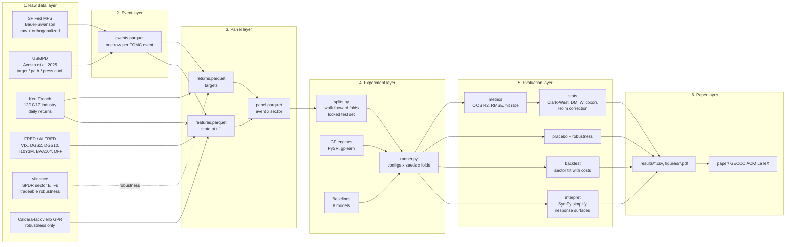

# Architecture and Publication Plan

**Project:** Interpretable State-Dependent Shock-Response Functions via Symbolic Regression
**Team:** two leads + Person 1 (GP & evaluation), Person 2 (baselines & statistics), Person 3 (data & features)

> **The final plan is [PROJECT_PLAN.md](PROJECT_PLAN.md).** It covers Stage 1 (club presentation, week 10) and Stage 2 (GECCO paper), who does what, and step-by-step tasks. Where the two files disagree, PROJECT_PLAN.md wins. This file is the deep reference for *why*.
**Primary target:** GECCO 2027 (Real World Applications or GP track, full paper or 4-page poster paper)
**Fallbacks:** IEEE CEC 2027, GECCO workshops (Symbolic Regression, XAI), EvoStar 2027 late-breaking abstract
**Status as of 2026-11-03:** `fetch_data.py`, `build_events.py` (222 FOMC events 1999–2025, Δ2y surprise) and `build_returns.py` (SPDR excess returns) work, documented in `docs/data_interface.md`. `build_features` and `models/` are stubs.
**Confirmed GECCO 2027 dates:** abstract **Jan 18, 2027**, full paper **Jan 25, 2027** (both non-extensible), notification Mar 19, in person in Kraków, Jul 12–16.


---

## 0. The paper in one paragraph

> Using roughly 260 identified FOMC monetary-policy surprises (1994 to 2025) and 12 US industry portfolios, we ask whether genetic-programming symbolic regression can find **closed-form, state-dependent formulas** for how each sector's event-day excess return depends on the surprise and the market state just before it. We compare GP (PySR, gplearn) with eight baselines on strict walk-forward splits, run 30 seeds per configuration, test significance with Clark-West and Wilcoxon tests, run placebos with shuffled surprises, and check whether the evolved formulas match known transmission channels (banks and the yield curve, long-duration tech, bond-like utilities).

The contribution is interpretable closed-form response functions plus a rigorous benchmark. "GP predicts market crashes" is not the contribution. A careful negative result (GP ties the linear model with interactions) can still be published at GP venues, so the design has to be built to make either outcome reportable.

### Draft title
*Evolving Interpretable Response Functions to Monetary Policy Surprises: A Symbolic Regression Benchmark on US Industry Returns*

### Research questions (freeze these in the pre-registration)
- **RQ1 (accuracy):** Does symbolic regression beat a linear event-study model out of sample, and does it beat a linear model with hand-picked interactions?
- **RQ2 (interpretability):** Are the selected formulas small (≤ 25 nodes) and stable across seeds, and do they match known economic channels?
- **RQ3 (economic value):** Does a sector long-short rule built on the formulas earn a positive Sharpe ratio on FOMC days after 5 to 10 bp per side in costs? This is illustrative only, not the headline.

### Hypotheses
- **H1:** The OOS MSE of the selected GP formula is lower than the linear event study's (Clark-West, one-sided, α = 0.05).
- **H2:** GP matches gradient-boosted trees within one standard error of OOS R² at ≤ 25 nodes.
- **H3:** Surprise sensitivity rises with pre-event VIX for rate-sensitive sectors (Ehrmann & Fratzscher 2004 state dependence).
- **H0 placebo:** With shuffled surprises, GP's OOS R² is ≤ 0 in at least 95% of runs.

---

## 1. System architecture



Design principles:
1. **One command rebuilds everything** from raw downloads (`make all` or `python -m src.pipeline`). Running it again reproduces the panel byte for byte.
2. **Every stage reads files and writes files** (Parquet). Stages never call each other in memory, so each can be tested and cached on its own.
3. **Time is the primary key.** Every feature has an `asof` timestamp, and tests assert `asof < event_timestamp`.
4. **Configs are data.** Every experiment is a YAML file with a hash. The runner logs every config it has ever run, which answers the multiple-testing question reviewers will ask.
5. **The test set is opened once,** by one person, after the design freeze.

---

## 2. What the current repo has and what has to change

| Area | Current state | Problem | Change |
|---|---|---|---|
| Shock measure | `build_events.py` uses the daily 2y yield change (`surprise_bp`) | Daily 2y change mixes the FOMC news with other news from that day, and raw surprises are partly predictable (Bauer & Swanson 2023). Reviewers will reject a team-built shock. | Use the **SF Fed Bauer-Swanson series** (`MPS`, `MPS_ORTH`) as the main shock and **USMPD** for target and path factors plus press-conference events. Keep the existing Δ2y as the v0 pipeline (fast for Gate 0) and as a robustness row. |
| Sector returns | `build_returns.py`: SPDR ETFs from yfinance, 1999+, excess vs SPY | XLK and the other SPDRs start Dec 1998, XLRE 2015, XLC 2018. That means fewer events and an unbalanced panel. | Use **Ken French 12-industry daily** as the main source (point-in-time industry definitions, history long before 1994). Keep the ETFs for the tradeable backtest and as a robustness check. |
| FRED series | DGS2, DGS10, VIXCLS, BAA10Y, DFF | No 10y-3m spread. VIX starts in 1990, which is fine. | Add `T10Y3M` and `DGS3MO`. Keep the existing series. These are market series and are not revised, so ALFRED is only needed if a revised macro series (CPI, payrolls) is added in phase 2. |
| File format | CSV | Slow, loses dtypes, timezone problems | Parquet (`pyarrow`). Keep CSV export for quick inspection. |
| Models | empty `src/models/` | n/a | See §5 and §6. |
| Dependencies | pandas, numpy, yfinance, sklearn, gplearn | Missing tools | Add `pysr`, `sympy`, `xgboost` or `lightgbm`, `statsmodels`, `econml` (causal forest), `pyarrow`, `pyyaml`, `scipy`, `matplotlib`, `pytest`. Pin exact versions in a lockfile before the experiments start. |
| Tests | none | Lookahead bugs are the fastest way to get rejected | Add the `tests/` suite in §8. |

---

## 3. Target repository layout

```
configs/
  base.yaml                 shared defaults (seeds, splits, costs)
  gp/pysr_default.yaml      one file per experiment config
  gp/gplearn_default.yaml
  baselines/*.yaml
  robustness/*.yaml         industries_10.yaml, subsample_post2008.yaml, ...
data/
  raw/                      untouched downloads (gitignored) + manifest.json with SHA-256 per file
  processed/                events, returns, features, panel (gitignored)
src/
  fetch_data.py             yfinance + FRED (exists)
  fetch_shocks.py           SF Fed MPS + USMPD downloads
  fetch_french.py           Ken French industry zips
  build_events.py           -> events.parquet
  build_returns.py          -> returns.parquet
  build_features.py         -> features.parquet
  build_panel.py            join -> panel.parquet (+ data card)
  splits.py                 walk-forward folds, test-set lock
  models/
    base.py                 Model protocol: fit / predict / complexity / to_sympy
    gp_pysr.py
    gp_gplearn.py
    linear.py               event study, interactions, LASSO/ElasticNet
    str.py                  smooth-transition regression
    forest.py               causal / generalized random forest
    boosting.py             XGBoost / LightGBM
    mlp.py
    naive.py                zero and historical mean
  runner.py                 config x seed x fold -> results/runs/*.parquet
  evaluate/
    metrics.py
    stats_tests.py          Clark-West, Diebold-Mariano, Wilcoxon, Holm
    placebo.py
    backtest.py
    interpret.py            SymPy simplify, response surfaces, formula stability
  pipeline.py               end-to-end entry point
tests/
  test_no_lookahead.py
  test_reproducibility.py
  test_panel_schema.py
  test_stats.py             test stats code against known reference values
notebooks/                  exploration only, no result in the paper comes from a notebook
results/
  registry.csv              one row per config ever run (hash, timestamp, git sha)
  runs/                     raw per-run outputs
  tables/  figures/
paper/
  main.tex                  ACM sigconf (GECCO template)
  sections/*.tex
  refs.bib
docs/
  ARCHITECTURE.md           this file
  PREREGISTRATION.md        frozen before any GP run
  DATA_CARD.md
  lit_review/
```

---

## 4. Data layer: specs

### 4.1 Events (`build_events.py` → `data/processed/events.parquet`)

| column | type | description |
|---|---|---|
| `event_id` | str | `FOMC_YYYYMMDD` |
| `event_date` | date | announcement date (ET) |
| `event_time` | time | statement release time (2:00 pm ET from 2013; mostly 2:15 pm before that) |
| `event_type` | cat | `scheduled`, `unscheduled`, `press_conf`, `minutes` |
| `mps` | float | Bauer-Swanson raw surprise (bp) |
| `mps_orth` | float | orthogonalized surprise (bp), **main shock** |
| `target_factor` | float | GSS current-target factor (USMPD) |
| `path_factor` | float | GSS future-path factor (USMPD) |
| `zlb` | bool | fed funds at the zero lower bound (Dec 2008 to Dec 2015, Mar 2020 to Mar 2022) |

Rules:
- Sample from **1994-02-04** (first same-day public statement) to the latest date in the SF Fed file. Check that file's actual coverage and write it in the data card.
- Mark unscheduled meetings (2001-01-03, 2001-09-17, 2008-10-08, 2020-03-03, 2020-03-15, ...) with a flag. The main spec **excludes** them: they are endogenous to crises, and the 2020-03-15 decision came on a Sunday. Report a robustness row that includes them.
- Scale the surprise in bp consistently. Sign convention: positive = hawkish.

Expected size: about 250 to 270 scheduled events, or about 3,000 to 3,200 event × sector rows with 12 industries.

### 4.2 Targets (`build_returns.py` → `returns.parquet`)

- `ret_0d` = industry return on the event day (Ken French daily returns already give the close(t-1) → close(t) change).
- **Primary target:** `xret_0d = ret_0d − mkt_0d` (industry minus value-weighted market). This isolates the cross-sector question.
- Secondary targets: raw `ret_0d`, and `xret_1d` (t-1 → t+1 close) for slow diffusion.
- Winsorize targets at the 0.5% and 99.5% quantiles **inside each training fold only**, not on the full sample.

### 4.3 Features (`build_features.py` → `features.parquet`)

Every state variable is measured at **close of t-1**. All rolling windows end at t-1.

| group | feature | formula / source |
|---|---|---|
| shock | `s` | `mps_orth` |
| shock | `s_target`, `s_path` | USMPD factors |
| shock | `hawk` | 1{s > 0} (lets GP find asymmetry) |
| state | `vix` | VIXCLS(t-1) |
| state | `term` | T10Y3M(t-1) |
| state | `credit` | BAA10Y(t-1) |
| state | `ff` | DFF(t-1) |
| state | `mkt_mom20` | market 20-day return to t-1 |
| sector | `mom20` | sector 20-day return to t-1 |
| sector | `beta_mkt` | 252-day rolling beta to the market, ending t-1 |
| sector | `beta_2y` | 252-day rolling beta to ΔDGS2, ending t-1 |
| sector | `vol60` | 60-day realized vol, ending t-1 |
| id | `sector` | one-hot, pooled models only |

Standardize features with the **training-fold** mean and std, saved per fold. Keep `s` in raw bp so the formulas stay readable (a formula in bp × VIX points reads better than one in z-scores). Write that choice in the paper.

### 4.4 Panel (`build_panel.py` → `panel.parquet`)
Inner join on `(event_id, sector)`. It also writes `DATA_CARD.md` with row counts per year, per sector, missingness, and summary stats. The data card goes in the paper's appendix.

---

## 5. GP engine (Person 1)

### 5.1 Model granularity
Run both and report both:
- **Per-sector models:** 12 separate formulas, about 260 rows each. Easiest to read, but each has very little data.
- **Pooled model:** one formula over all rows, with sector traits (`beta_mkt`, `beta_2y`) as inputs instead of one-hots. This is the stronger story: *one* readable law of how rate sensitivity and market state govern reactions.

### 5.2 PySR (main engine)

```yaml
# configs/gp/pysr_default.yaml
engine: pysr
binary_operators: ["+", "-", "*", "/"]      # PySR's "/" is protected
unary_operators: ["tanh", "abs"]
extra: ["max", "min"]                        # as binary operators
maxsize: 25
maxdepth: 8
parsimony: 0.0032                            # tune on validation, from a small grid
niterations: 200
populations: 30
population_size: 50
model_selection: "best"                      # we re-select on validation ourselves
constraints: {"/": [-1, 9], "tanh": 5}
nested_constraints: {"tanh": {"tanh": 0}}
loss: "L2DistLoss()"                         # also try Huber for robustness
deterministic: true
parallelism: "serial"                        # required for seed reproducibility
random_state: <seed>
```

Selection rule (pre-registered): from the Pareto front saved at the end of training, pick the expression with the **lowest validation MSE**. Ties go to the smaller expression. Test data is never used for selection.

### 5.3 gplearn (second GP baseline)
`SymbolicRegressor(population_size=1000, generations=50, tournament_size=20, function_set=('add','sub','mul','div','max','min','abs','neg'), parsimony_coefficient` tuned on validation`, max_samples=0.9, random_state=seed)`.
This answers "is it PySR's constant optimization, or GP itself?"

### 5.4 Seeds and budget
- `seeds = [0..29]`, saved in `configs/base.yaml` and in the paper.
- **Equal tuning budget for every model:** each baseline gets the same number of hyperparameter evaluations on validation as GP gets parsimony settings (for example 8).
- Log wall-clock time per run. GECCO reviewers ask about it.

### 5.5 "Why GP and not an LLM-guided search?"
2027 reviewers will ask this. Have a short answer: GP is the established baseline for formula discovery, it is cheap, reproducible and has no training-data contamination, which matters because LLMs have read Bernanke-Kuttner. Optional stretch: one LLM-SR style run as an extra comparison.

---

## 6. Baselines (Person 2)

| # | model | implementation | why |
|---|---|---|---|
| 0 | zero / historical mean | `naive.py` | floor for OOS R² |
| 1 | linear event study, per sector: `xret = a + b·s` | statsmodels OLS | Bernanke-Kuttner standard |
| 2 | linear + interactions: `s·vix`, `s·term`, `s·credit`, `s·hawk` | OLS | tests whether GP finds anything an economist wouldn't write |
| 3 | LASSO / ElasticNet on all features + all pairwise `s×` interactions | sklearn | regularized linear |
| 4 | smooth-transition regression (VIX as transition variable) | custom NLS in `str.py` | the econometric nonlinear model already used for this question |
| 5 | causal / generalized random forest | `econml.CausalForestDML` or `grf` via rpy2 | Errico et al. 2025 method |
| 6 | gradient-boosted trees | LightGBM / XGBoost | strong black box |
| 7 | small MLP (1 to 2 layers, 16 to 32 units, early stopping) | sklearn | Stasinakis tradition |

**Gate 0 (do this before any GP run):** reproduce Bernanke & Kuttner. A hawkish surprise lowers broad returns, and cyclical and long-duration industries react most. If the pipeline doesn't recover this, stop and fix the data.

---

## 7. Evaluation protocol

### 7.1 Splits (`splits.py`)
Expanding-window walk-forward at the **event** level. Never shuffle, and never split one event's sector rows across folds.

`docs/data_interface.md` already puts the train/test cut at 2016, and this plan keeps it, because a longer test window gives the significance tests more power:

```
DEVELOPMENT (all tuning, all design choices): 1994-02 → 2015-12   (~170 scheduled events)
  Fold 1: train 1994–2003 | val 2004–2006
  Fold 2: train 1994–2006 | val 2007–2009
  Fold 3: train 1994–2009 | val 2010–2012
  Fold 4: train 1994–2012 | val 2013–2015
LOCKED FINAL TEST: 2016-01 → latest (~80 scheduled events, includes the 2022 hiking cycle)
  Final model: retrain on 1994–2015 using the frozen config, predict 2016+.
  Optional: expanding re-fit each year in the test period (also frozen in advance).
```
Notes:
- ZLB years (2009–2015, 2020–2021) have small surprises. Report results with and without ZLB events.
- `splits.py` refuses to return locked-test indices unless `UNLOCK_TEST=1` is set, and it logs who set it and when.
- With the SPDR panel (1999+) the dev period is 1999–2015, so fold 1 starts later.

### 7.2 Metrics (`metrics.py`)
- **OOS R²** vs the training-fold historical mean (Campbell-Thompson style). This is the primary metric.
- RMSE, MAE, directional hit rate.
- Complexity: node count after SymPy simplification.
- **Formula stability:** across 30 seeds, the share of runs whose selected formula contains the `s × vix` term (or another named term), and the Jaccard similarity of feature sets.

### 7.3 Statistical tests (`stats_tests.py`)
- **Event-level clustering matters.** The 12 sector rows from one event share the same shock, so they are not independent. Aggregate losses to **one loss per event** (mean over sectors) before running DM or Clark-West. Otherwise the effective sample size is overstated by about 12×.
- Clark-West for GP vs nested linear models; Diebold-Mariano (HAC variance) for non-nested ones.
- Wilcoxon signed-rank across the 30 seeds (GP run-level metric vs the baseline's deterministic metric, or seed-matched for stochastic baselines). Report Vargha-Delaney A12 effect sizes.
- Holm-Bonferroni correction across the family of comparisons. State the family size, and count every config in `results/registry.csv`.

### 7.4 Placebos (`placebo.py`)
1. Permute `s` across events (keeping each event's 12 rows together), 30 seeds. Expect OOS R² ≤ 0.
2. Non-event days: draw random non-FOMC days, assign them real surprise values, and rerun.
3. Time-shift: use the surprise from event t-1 to predict reactions at event t.

### 7.5 Robustness grid (`configs/robustness/`)
10 / 12 / 17 industries · SPDR ETFs (1999+) · `mps` vs `mps_orth` · target + path factors vs single surprise · include press conferences · include unscheduled · pre/post-2008 · Huber loss · `xret_1d` target · GPR index added as a state variable.

### 7.6 Economic value (`backtest.py`)
On each test-fold event day, go long the top 3 predicted sectors and short the bottom 3. Timing caveat: the forecast needs the surprise, which is only known at the 2:00 pm release, but the close-to-close target also includes the morning before the release. A tradeable version therefore enters at the post-release ETF price and needs intraday data. Without intraday data, frame the result honestly as a **conditional-on-surprise** analysis ("if you knew the surprise, which tilt would have paid"), not a trading strategy. Apply 5 to 10 bp per side and report Sharpe and max drawdown. This is where the SFIC Quant portfolio case study goes.

### 7.7 Interpretation (`interpret.py`)
- Simplify each selected formula with SymPy and print it in LaTeX.
- Response-surface plots: surprise on the x-axis, VIX on the y-axis, predicted excess return as color, one panel per sector.
- Channel check table: Financials vs `term`, Tech vs `s_path`, Utilities as bond-like. Does each evolved formula agree in sign with the theory?
- Partial dependence for LightGBM on the same axes, to compare GP with the black box.

---

## 8. Reproducibility and correctness

| test | asserts |
|---|---|
| `test_no_lookahead.py` | for every row, `max(feature_asof) < event_timestamp`; rolling windows end at t-1; standardization stats come from the training fold only |
| `test_reproducibility.py` | the same seed and config give the same PySR expression string; rebuilding the panel from raw gives the same SHA-256 |
| `test_panel_schema.py` | dtypes, no NaN in the main spec, 12 rows per event |
| `test_stats.py` | DM / Clark-West match reference values on a toy series |

Other practices:
- `data/raw/manifest.json` stores the download date and SHA-256 of every raw file. Archive the raw files on Zenodo when you submit, if their licenses allow it. Ken French and FRED do; check the SF Fed terms.
- Each result row stores `git_sha`, `config_hash`, `seed`, `fold`, and package versions.
- Make the GitHub repo public with a DOI (Zenodo) when you submit, or keep an anonymized mirror (anonymous.4open.science) if GECCO's double-blind rules require one. **Check the 2027 call.**

---

## 9. Paper structure (GECCO ACM sigconf, 8 pages + references)

| section | pages | content | owner |
|---|---|---|---|
| 1 Introduction | 0.75 | gap, RQs, 3 contributions | Leads |
| 2 Related work | 0.75 | GP in finance; macro-shock event studies; SR & ML for state dependence | Leads |
| 3 Data & shock identification | 1.0 | events, targets, features, timing figure | Person 3 |
| 4 Method | 1.0 | GP setup, selection rule, baselines, equal budget | Person 1, Person 2 |
| 5 Experimental protocol | 0.75 | splits, tests, placebos | Person 2 |
| 6 Results | 2.0 | Table 1 accuracy; Table 2 significance; Fig. response surfaces; formula table | all |
| 7 Interpretation & economic value | 1.0 | channel check, backtest | Person 1, Person 3 |
| 8 Threats to validity & conclusion | 0.5 | small sample, ZLB, single shock family | Leads |
| Appendix / supplement | — | data card, full robustness grid, config registry | Person 3 |

Key figures and tables:
1. Timing diagram (t-1 close state → 2:00 pm release → t close return).
2. Table: OOS R², RMSE, hit rate, complexity for all models (median ± IQR across seeds).
3. Table: Clark-West / DM p-values, Holm-adjusted; Wilcoxon + A12.
4. Figure: accuracy vs complexity Pareto front (GP) with baselines as points.
5. Figure: response surfaces for 4 representative sectors.
6. Table: simplified formulas per sector + channel-check signs.
7. Figure: placebo OOS R² distribution vs real.

---

## 10. Timeline (today: Tue 2026-11-03; GECCO abstract Jan 18, paper Jan 25, 2027)

The per-task version is in [PROJECT_PLAN.md](PROJECT_PLAN.md). Summary:

| week | dates | milestone | gate |
|---|---|---|---|
| 1 | Nov 3–9 | Pre-registration drafted; repo refactor to §3; `fetch_shocks.py`, `fetch_french.py` | leads sign off on RQs |
| 2 | Nov 10–16 | `build_events/returns/features/panel` + tests pass | `test_no_lookahead` green |
| 3 | Nov 17–23 | Baselines 0–2; **Gate 0: reproduce Bernanke-Kuttner** | sign and size match the literature |
| 4 | Nov 24–30 | PySR + gplearn harness, 30-seed runner, registry | one full fold runs unattended |
| 5 | Dec 1–7 | Baselines 3–7; equal-budget tuning | all models produce val predictions |
| 6 | Dec 8–14 | Placebos; first full walk-forward on the dev period (finals week: lighter) | placebo R² ≤ 0 |
| 7–8 | Dec 15–28 | Robustness grid; interpretation tooling; draft §1–5 | **design freeze Dec 28** |
| 9 | Dec 29–Jan 4 | **Unlock final test once**; run everything | results logged, no reruns with new configs |
| 10 | Jan 5–11 | Tables and figures; draft §6–8 | full draft |
| 11 | Jan 12–18 | Internal review + **faculty advisor review**; anonymize | — |
| 12 | Jan 18–25 | **Abstract Jan 18**, polish, **submit Jan 25** | submitted |
| — | Mar 15 (check) | IEEE CEC 2027 fallback (sources disagree: Feb 28 or Mar 15) | — |
| — | Mar 21 | EvoStar late-breaking abstract (preliminary results / extension) | — |
| — | Mar–Apr | GECCO workshop papers (SR, XAI) if the main track rejects or as a companion | — |
| — | Jul 2027 | GECCO Kraków: present | — |
| — | later | Extended journal version (GPEM / Applied Soft Computing) adding CPI and payrolls shocks; or ACM ICAIF 2027 | — |

GECCO 2027 dates come from the official call (gecco-2027.sigevo.org). Re-check CEC and EvoStar dates on their own sites.

---

## 11. Team workstreams

See [PROJECT_PLAN.md](PROJECT_PLAN.md) for the week-by-week steps.

| Workstream | Who | Done when |
|---|---|---|
| Research question, pre-registration, advisor, intro and related work, final review | Leads | `PREREGISTRATION.md` signed before any Stage 2 GP run; draft to advisor Jan 11 |
| GP & evaluation | Person 1 | 30-seed × all-fold runs finish unattended; registry complete; formulas interpreted |
| Baselines & statistics | Person 2 | Gate 0 passed; all baselines with equal budget; tests checked against reference values |
| Data & features | Person 3 | `python -m src.pipeline` rebuilds the panel with the same hash; no-look-ahead tests green |

**Agree on authorship order and the corresponding author now, in writing.** It matters for later credentials (see §13).

---

## 12. Risks and mitigations

| risk | likelihood | mitigation |
|---|---|---|
| No faculty co-author | high | Email 2–3 UCSD faculty (Rady finance, economics, CSE evolutionary computation) **this week** with this doc and the 1-page pre-reg. This is the biggest lever on acceptance odds. |
| GP doesn't beat the linear model with interactions | medium–high | Pre-register a negative-result framing: "rigorous benchmark + interpretable formulas that recover theory." Target the GECCO SR workshop or poster. |
| Too few events per sector (~260) | certain | Pooled model; event-level inference; strong parsimony; report confidence intervals honestly. |
| Lookahead leak found late | medium | Tests in §8 from week 2; code review on every PR. |
| SF Fed series doesn't cover recent years | medium | USMPD covers more recent years; otherwise end the sample at the last covered date and say so. |
| Deadline slips over finals | medium | CEC (Feb 28) is a ready fallback with the same paper. |
| SFIC club policy on publishing | unknown | Leads ask the SFIC president what "it can't be" meant before the work goes much further. |
| Double-blind conflict with a public repo | low | Anonymized mirror during review. |

---

## 13. On the O-1 goal (read this honestly)

O-1A requires meeting at least 3 of 8 criteria, followed by a merits review of *sustained* national or international acclaim. A single peer-reviewed conference paper supports **one** criterion (authorship of scholarly articles), and a five-author student paper won't carry a petition by itself. To get the most from this project:

- **Aim for the main track, not just a poster.** Full papers at CORE-A venues (GECCO) count more than abstracts.
- **Get citations and use:** release the pipeline as a clean, documented open-source package (for example `pip install` + a Zenodo DOI). Downloads, GitHub stars, and other people using it can support the "original contributions of major significance" criterion.
- **Judging criterion:** volunteer as a reviewer or sub-reviewer for GECCO / EvoStar / CEC workshops, and ask the faculty advisor to bring you in as a sub-reviewer. Keep the invitation emails.
- **Follow-on work:** an extended journal version (GPEM) and a second paper (CPI and payrolls shocks, or ICAIF) build a *record* rather than a one-off.
- **Expert letters:** the faculty co-author and the GECCO track chairs you meet are possible future letter writers.
- **Authorship position** matters to evidence reviewers. Settle it early (§11).
- Talk to an immigration attorney before relying on any of this. This is not legal advice.

---

## 14. This week's concrete actions (superseded by PROJECT_PLAN.md week 6)

1. **Leads:** write `docs/PREREGISTRATION.md` from §0 and §7. Email faculty about advising. Ask the SFIC president about the publishing policy.
2. **Person 3:** add `fetch_shocks.py` (SF Fed MPS xlsx + USMPD) and `fetch_french.py` (12/10/17-industry daily zips). Switch outputs to Parquet. Add a raw manifest.
3. **Person 1:** add `pysr` and pin dependencies. Write `models/base.py` (Model protocol) and a PySR smoke test on synthetic data with a known formula (for example `y = -0.04·s·(1+0.05·max(0,vix-20))`). Confirm the run is deterministic and that the formula is recovered.
4. **Person 2:** write `splits.py` with the test-set lock, plus `stats_tests.py` with Clark-West and DM, checked against reference values.
5. **Everyone:** read Brabazon, Kampouridis & O'Neill (2020) first. It is effectively the reviewer checklist.

---

## Key references
Bernanke & Kuttner (2005, JF) · Ehrmann & Fratzscher (2004, ECB WP 354) · Gürkaynak, Sack & Swanson (2005, IJCB) · Bauer & Swanson (2023, NBER Macro Annual) · Acosta et al. (2025, FRBSF WP 2025-30) · Neely, Weller & Dittmar (1997, JFQA) · Allen & Karjalainen (1999, JFE) · Brabazon, Kampouridis & O'Neill (2020, GPEM) · La Cava et al. (2021, NeurIPS D&B) · Errico, Pesce & Pollio (2025) · Caldara & Iacoviello (2022, AER) · Ramelli & Wagner (2020, RCFS) · Chen & Yeh (2000, AOR) · Stasinakis (2013, Glasgow PhD) · Shi, Duan & Li (2025, AAAI). Full list in `paper/refs.bib` (to create).

---

## 15. Novelty check and publishability (searched 2026-11-03)

### 15.1 What we searched
About 30 targeted web searches, plus reading the GECCO 2026/2027 calls and the SF Fed data pages. Query families:
- GP / symbolic regression × (FOMC, monetary policy surprise, Fed announcement, central bank, interest-rate shock)
- symbolic regression × (asset pricing, stock returns, event study, impulse response, macroeconomic)
- ML × state-dependent / heterogeneous stock responses to monetary shocks
- GP × macro announcements (CPI, payrolls) and news-driven returns
- other interpretable competitors: Kolmogorov-Arnold networks (KANs), LLM-guided symbolic regression
- recent work from the main GP-finance group (Kampouridis et al.)

### 15.2 Result
**No paper found applies GP or symbolic regression to identified monetary-policy surprises to explain how industries or sectors react.** The pieces exist separately:

| Nearby work | What it does | How we differ |
|---|---|---|
| Bernanke & Kuttner 2005 (JF) | Linear event study; industries react differently | We find state-dependent formulas, not one slope |
| Monetary policy uncertainty & surprises (J. Econ. Bus. 2022) | Smooth-transition model: reaction is stronger when uncertainty is high | Shape fixed in advance, one state variable |
| Errico, Pesce & Pollio (ECB WP 3107, 2025; CBI RTP 06/RT/26, 2026) | Generalized random forest; nonlinear firm-level responses to macro shocks, monetary policy as a robustness check | Black box; firm sales and investment, not event-day sector returns |
| Ozdagli & Weber (production networks) | 50–85% of the stock reaction to monetary shocks runs through input-output links | Structural, not discovered formulas; a useful channel for the interpretation section |
| Predicting reactions to FOMC statements (Digital Finance 2023) | Random forest on statement text | Uses text, not surprise × state |
| Causal state-dependent local projections (arXiv 2605.05404, 2026) | Linear interaction models can misstate state dependence | Supports our motivation |
| GP in finance (Kampouridis group, GECCO 2023, KBS 2025, IEEE Access 2025/26) | Trading rules, directional changes, sentiment | No macro shocks |
| Formulaic alpha mining (AlphaForge, the 2026 EC alpha survey) | Formula search for daily return prediction | Not shock responses |
| KANs in finance (KASPER 2025; VIX forecasting with KANs 2025) | Interpretable, sometimes closed-form forecasts | Not monetary shocks. **A competing interpretable method that reviewers may raise** |
| LLM-SR (ICLR 2025 oral) and LLM-guided SR (GECCO 2026 companion) | LLM + evolutionary equation discovery | No finance or economics use found. **Expect "why not LLM-SR?"** |

### 15.3 Claims we can and cannot make
- **Can claim:** the first interpretable, closed-form, state-dependent response functions for US industry returns to identified FOMC surprises, discovered by symbolic regression and benchmarked against linear, smooth-transition, forest and boosting models under strict walk-forward evaluation.
- **Cannot claim:** that GP is the first method to find nonlinear or state-dependent shock responses (forests and smooth-transition models did that); that GP predicts crises, pandemics or wars; or that the result is a profitable trading strategy.
- **Must cite and compare to:** Bernanke-Kuttner, the 2022 smooth-transition paper, Errico et al., and the causal state-dependent LP paper. Add KANs and LLM-SR as optional extra baselines, or at least discuss them.

### 15.4 Remaining checks before writing (leads, ~3 hours, by Nov 16)
1. GP Bibliography (gpbib.cs.ucl.ac.uk) keyword search: `monetary`, `central bank`, `announcement`, `macroeconomic news`, `event study`.
2. Google Scholar: `"symbolic regression" "monetary policy"`, `"genetic programming" FOMC`, `"symbolic regression" "stock returns"`, plus papers that cite Bernanke & Kuttner 2005 and also mention "genetic programming" or "symbolic".
3. SSRN and arXiv q-fin / econ.EM, last 3 years: `symbolic regression`, `equation discovery`.
4. GECCO 2024–2026 proceedings and companions (RWA track, GP track, SR and ECXAI workshops), EvoApplications 2025–2026, CEC 2025–2026.
5. Repeat searches 1–3 the week of Jan 11, 2027 in case something was just posted.
Write each search, date and finding into `docs/lit_review/novelty_log.md`.

### 15.5 Venue facts (from official calls where marked ✔)
| Venue | Key facts |
|---|---|
| GECCO 2027 ✔ | Abstract Jan 18, paper and poster-only Jan 25 (non-extensible); notification Mar 19; camera-ready Apr 9; **in person only**, Kraków, Jul 12–16. Full papers 8 pages + references; poster-only 4 pages including references. Double-blind; arXiv preprints allowed. **New for 2027: source code is expected with the submission.** **Any AI-tool use in the research must be disclosed in Methods.** At most 40% of each track's full papers accepted; no cap on posters, including "poster papers submitted originally as full paper." 14 tracks; the GP track is chaired by Kronberger and Olivetti de França (both symbolic-regression researchers). |
| GECCO 2025 | 181 / 501 full papers accepted (36.1%) |
| EvoStar 2027 | Mainz, Mar 31 – Apr 2; full papers closed Nov 1, 2026; late-breaking abstracts due **Mar 21, 2027** (the 2026 limit was 4 pages) |
| IEEE CEC 2027 | Edinburgh, Jul 25–28. Paper deadline **Mar 15, 2027** per the official CFP PDF (a third-party listing says Feb 28). Verify. |
| SR workshop | Ran at GECCO 2025 and at WCCI/CEC 2026; watch for a 2027 call |
| ECXAI workshop | Ran at GECCO 2026 (8 pages, double-blind, late-March deadline); likely again in 2027 |

**Travel note:** GECCO 2027 is in person only. At least one author must present in Poland, so check visa and re-entry status early.

### 15.6 Chances (judgment, assuming solid execution)
| Outcome | No faculty advisor | With faculty advisor |
|---|---|---|
| EvoStar late-breaking abstract | 70–85% | 80–90% |
| GECCO poster (direct or downgraded from full) | 50–65% | 65–80% |
| GECCO workshop paper (SR / ECXAI) | 45–60% | 60–75% |
| IEEE CEC full paper | 30–45% | 45–60% |
| **GECCO main-track full paper** | **10–20%** | **25–35%** |
| ACM ICAIF | 5–10% | 10–20% |
| Top finance / economics journal | ~0% | <5% |

Odds of getting *some* peer-reviewed output by mid-2027: about 70–80%. What lowers them: lookahead bugs, weak baselines, only one lucky GP run, overclaiming. What raises them: a faculty co-author, the Bernanke-Kuttner replication passing, formulas that are stable across seeds and match economic channels, and clean released code (now expected by GECCO 2027).
