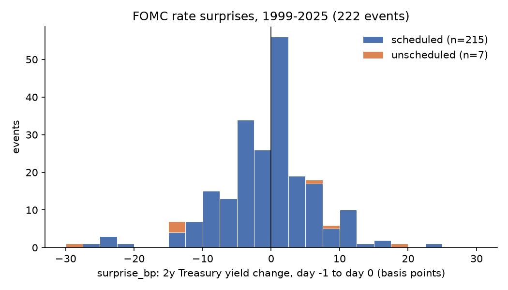

# Stage 1 data report

Generated by `python -m src.data_report` from the files in `data/processed/`. Rerun after any change to the build scripts.

## 1. What is in the panel

- **222 FOMC events** from 1999-02-03 to 2025-12-10: 215 scheduled, 7 unscheduled (between-meeting cuts).
- **2,142 (event, sector ETF) rows** across 11 SPDR sector ETFs; SPY is the benchmark, not a row.
- Surprise (`surprise_bp`): mean -1.1 bp, sd 7.4 bp, median 0.0, range -28 to 23. 39 events move the 2y by 10 bp or more; 21 move it by exactly 0.

### Events per year

| year | scheduled | unscheduled | mean |surprise| bp |
|---|---|---|---|
| 1999 | 8 | 0 | 5.5 |
| 2000 | 8 | 0 | 2.5 |
| 2001 | 8 | 3 | 6.8 |
| 2002 | 8 | 0 | 5.1 |
| 2003 | 8 | 0 | 8.4 |
| 2004 | 8 | 0 | 6.6 |
| 2005 | 8 | 0 | 4.5 |
| 2006 | 8 | 0 | 4.9 |
| 2007 | 8 | 0 | 9.5 |
| 2008 | 8 | 2 | 11.0 |
| 2009 | 8 | 0 | 5.5 |
| 2010 | 8 | 0 | 2.8 |
| 2011 | 8 | 0 | 1.8 |
| 2012 | 8 | 0 | 1.2 |
| 2013 | 8 | 0 | 2.8 |
| 2014 | 8 | 0 | 4.2 |
| 2015 | 8 | 0 | 5.8 |
| 2016 | 8 | 0 | 4.2 |
| 2017 | 8 | 0 | 3.8 |
| 2018 | 8 | 0 | 1.8 |
| 2019 | 8 | 0 | 5.2 |
| 2020 | 7 | 2 | 4.0 |
| 2021 | 8 | 0 | 1.8 |
| 2022 | 8 | 0 | 9.8 |
| 2023 | 8 | 0 | 11.8 |
| 2024 | 8 | 0 | 7.0 |
| 2025 | 8 | 0 | 4.4 |

### Rows per ticker

XLRE (real estate) starts in 2015-10 and XLC (communication services) in 2018-06, so they have fewer rows. Split option A uses the other 9 tickers only.

| ticker | rows | first | last | mean_excess_1d_pct | sd_excess_1d_pct |
|---|---|---|---|---|---|
| XLB | 222 | 1999-02-03 | 2025-12-10 | 0.044 | 1.163 |
| XLC | 61 | 2018-08-01 | 2025-12-10 | 0.039 | 0.679 |
| XLE | 222 | 1999-02-03 | 2025-12-10 | -0.079 | 1.501 |
| XLF | 222 | 1999-02-03 | 2025-12-10 | 0.100 | 1.394 |
| XLI | 222 | 1999-02-03 | 2025-12-10 | -0.020 | 0.639 |
| XLK | 222 | 1999-02-03 | 2025-12-10 | 0.149 | 1.133 |
| XLP | 222 | 1999-02-03 | 2025-12-10 | -0.284 | 1.205 |
| XLRE | 83 | 2015-10-28 | 2025-12-10 | -0.275 | 1.143 |
| XLU | 222 | 1999-02-03 | 2025-12-10 | -0.261 | 1.209 |
| XLV | 222 | 1999-02-03 | 2025-12-10 | -0.084 | 0.836 |
| XLY | 222 | 1999-02-03 | 2025-12-10 | 0.063 | 0.818 |

## 2. The 10 largest surprises (by |surprise_bp|)

Sanity check that big values are real events, not data errors. All ten are real, well-known Fed days. Several show the weakness of a 2y-yield proxy: on 2007-12-11 and 2008-10-08 the yield moved *against* the direction of the rate action because the day's growth fears or safe-haven flows dominated. Stage 2 replaces this proxy with the Bauer-Swanson (SF Fed) surprise series.

| event_date | event_type | surprise_bp | spy_1d_pct | why |
|---|---|---|---|---|
| 2008-01-22 | unscheduled | -28.0 | -1.0 | Emergency 75bp cut, announced before the open after a global stock sell-off. |
| 2023-12-13 | scheduled | -27.0 | 1.4 | Hold at 5.25-5.50%; dot plot showed three 2024 cuts and Powell sounded dovish. |
| 2022-06-15 | scheduled | -25.0 | 1.4 | 75bp hike (largest since 1994) was already priced after the leak; Powell said moves this size would not be common, so the 2y fell. |
| 2007-12-11 | scheduled | -23.0 | -2.7 | Only a 25bp cut when some wanted 50; stocks fell ~2% and money ran to Treasuries (a growth scare, not a hawkish surprise). |
| 2008-03-18 | scheduled | 23.0 | 4.2 | 75bp cut, two days after the Bear Stearns rescue; relief rally pushed the 2y up. |
| 2009-03-18 | scheduled | -23.0 | 2.2 | QE1 expansion: Fed announced $300bn of Treasury purchases and more MBS buying. |
| 2023-03-22 | scheduled | -21.0 | -1.7 | 25bp hike one week after SVB failed; statement softened guidance on more hikes. |
| 2008-10-08 | unscheduled | 18.0 | -2.5 | Coordinated 50bp cut with five other central banks, announced 7:00 a.m. ET; the 2y rose as flight-to-safety demand eased. |
| 2004-01-28 | scheduled | 17.0 | -1.1 | Fed dropped the 'considerable period' pledge (replaced with 'patient'); hike signal sent the 2y up. |
| 2003-06-25 | scheduled | 16.0 | -1.0 | Cut 25bp to 1% when markets expected 50bp, so short yields rose. |

## 3. Features

Every feature is measured at **day -1** (the last trading day before the announcement), so nothing after the Fed decision leaks in. `tests/test_features.py` checks this by scrambling all data from day 0 on and confirming no feature changes.

Missing values: beta_1y needs 126 days of history, so it is missing for the first 3 events of 1999 and the first events after XLRE / XLC launched; mom_20d is missing only for XLC's first event. No macro value is missing or stale.

| feature | missing | mean | sd | min | max |
|---|---|---|---|---|---|
| surprise_bp | 0 | -1.1662 | 7.4073 | -28.0000 | 23.0000 |
| vix | 0 | 20.6383 | 8.6222 | 9.4300 | 66.9600 |
| slope_2s10s | 0 | 0.9793 | 0.9554 | -0.9400 | 2.7800 |
| beta_1y | 34 | 0.9009 | 0.3027 | 0.0374 | 2.1540 |
| mom_20d | 1 | 0.0074 | 0.0594 | -0.4133 | 0.3422 |
| credit | 0 | 2.4491 | 0.7341 | 1.3900 | 6.1000 |
| ff | 0 | 2.1907 | 2.0900 | 0.0400 | 6.6800 |
| vol_60d | 11 | 0.0127 | 0.0072 | 0.0037 | 0.0692 |
| mkt_mom_20d | 0 | 0.0073 | 0.0493 | -0.2010 | 0.1428 |

### Correlation matrix (all rows)

|  | surprise_bp | vix | slope_2s10s | beta_1y | mom_20d | credit | ff | vol_60d | mkt_mom_20d |
|---|---|---|---|---|---|---|---|---|---|
| surprise_bp | 1.00 | -0.09 | 0.11 | 0.01 | 0.04 | -0.05 | -0.07 | -0.11 | 0.05 |
| vix | -0.09 | 1.00 | 0.21 | -0.03 | -0.38 | 0.68 | -0.11 | 0.69 | -0.47 |
| slope_2s10s | 0.11 | 0.21 | 1.00 | 0.13 | -0.05 | 0.55 | -0.71 | 0.04 | -0.06 |
| beta_1y | 0.01 | -0.03 | 0.13 | 1.00 | 0.01 | 0.06 | -0.19 | 0.29 | 0.02 |
| mom_20d | 0.04 | -0.38 | -0.05 | 0.01 | 1.00 | -0.15 | -0.00 | -0.07 | 0.78 |
| credit | -0.05 | 0.68 | 0.55 | 0.06 | -0.15 | 1.00 | -0.42 | 0.56 | -0.20 |
| ff | -0.07 | -0.11 | -0.71 | -0.19 | -0.00 | -0.42 | 1.00 | -0.00 | -0.00 |
| vol_60d | -0.11 | 0.69 | 0.04 | 0.29 | -0.07 | 0.56 | -0.00 | 1.00 | -0.10 |
| mkt_mom_20d | 0.05 | -0.47 | -0.06 | 0.02 | 0.78 | -0.20 | -0.00 | -0.10 | 1.00 |

Pairs with |corr| >= 0.5: vix-credit +0.68; vix-vol_60d +0.69; slope_2s10s-credit +0.55; slope_2s10s-ff -0.71; mom_20d-mkt_mom_20d +0.78; credit-vol_60d +0.56. Correlated inputs are fine for prediction but make individual linear coefficients and GP terms harder to interpret; mention this when reading the formulas.

surprise_bp is close to uncorrelated with every day -1 feature, as it should be: a surprise that could be predicted from yesterday's VIX or yield curve would not be a surprise.

## 4. Check: 2008-10-08 coordinated cut

- The Fed and five other central banks cut 50bp at **7:00 a.m. ET on Wed 2008-10-08**, before the stock market opened. So the reaction day is the same day.
- Our data: trade_date = **2008-10-08** (correct), event_type = fomc_unscheduled, surprise_bp = +18.
- SPY day-0 return in our data: **-2.52%** (yfinance close 2008-10-07 -> 2008-10-08).
- Outside source: the **S&P 500 index closed at 984.94, -1.13%** (996.23 the day before; AP/Star-Bulletin, matches Yahoo's ^GSPC).
- **Finding: SPY and the index disagree by -1.39 pp on this day.** The raw (unadjusted) SPY close shows the same drop, so it is not a dividend-adjustment bug. Yahoo's pre-2009 ETF closes appear to come from a later print than the 4:00 p.m. index close, and on a day with a violent last half-hour that matters.
- How common: across all 7,154 days, SPY and the index differ by more than 0.5 pp on 244 days, mostly 1998-2002 and 2008 (20% of 2008 days; 0% in 2010-2019). On our 222 event days: 6 days, median gap 4.2 bp; correlation 0.992.
- **Impact:** small for the model. The target is the sector ETF minus SPY, and both come from the same Yahoo close, so the timing mostly cancels. It does mean the pre-2009 *level* of returns is noisier than the index, and 2008-10-08 is one of the noisiest rows. Robustness: rerun with this event dropped (or with all unscheduled events dropped) and report whether the conclusion changes.

Event days with the largest SPY vs. S&P 500 gap (percent):

| trade_date | spy | gspc | gap |
|---|---|---|---|
| 2008-10-08 | -2.52 | -1.13 | -1.39 |
| 2020-03-16 | -10.94 | -11.98 | +1.04 |
| 1999-11-16 | +0.84 | +1.84 | -1.01 |
| 2000-12-19 | -2.04 | -1.30 | -0.74 |
| 2005-11-01 | +0.30 | -0.35 | +0.65 |
| 2000-03-21 | +2.05 | +2.56 | -0.50 |

Sector moves that day (percent): materials and energy beat SPY by 4-6 pp while financials lagged, plausible for a day of commodity rebound and bank stress. These are among the largest excess returns in the panel, so check model results with and without this event.

| ticker | ret_1d | excess_1d |
|---|---|---|
| XLB | +3.23 | +5.75 |
| XLE | +1.89 | +4.41 |
| XLF | -4.02 | -1.50 |
| XLI | -1.53 | +0.99 |
| XLK | -0.90 | +1.62 |
| XLP | -2.73 | -0.22 |
| XLU | -1.74 | +0.78 |
| XLV | -1.80 | +0.72 |
| XLY | -1.95 | +0.57 |

## Sources

- [Fed press release, 2008-10-08 (7:00 a.m. EDT)](https://www.federalreserve.gov/newsevents/pressreleases/monetary20081008a.htm)
- [ECB joint statement, 2008-10-08](https://www.ecb.europa.eu/press/pr/date/2008/html/pr081008.en.html)
- [S&P 500 close 984.94 on 2008-10-08 (Star-Bulletin / AP)](https://archives.starbulletin.com/content/20081009_Stocks_end_lower_after_Fed_rate_cut.html)
- [2007-12-11 cut and 2y move (CNN Money)](https://money.cnn.com/2007/12/11/markets/markets_0500/)
- [2022-06-15 hike and 2y move (MNI)](https://www.mnimarkets.com/articles/bull-steeper-as-powell-vacillates-on-another-75)
