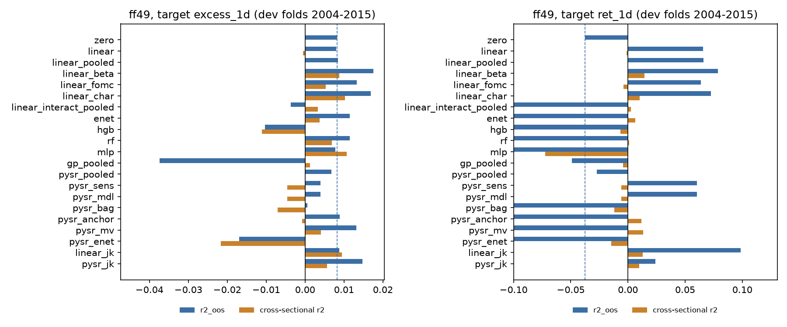
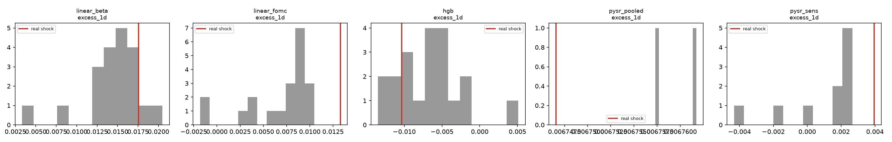
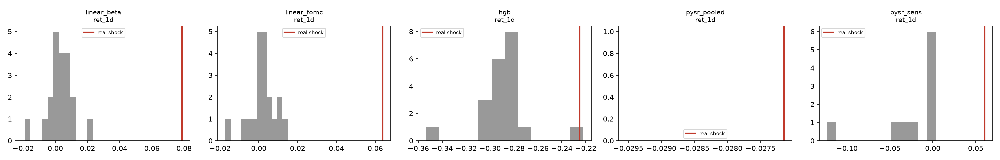

# Stage 2 dev results

Generated by `python -m src.v1.report`. Walk-forward dev folds: train from 1994 through 2003 / 2006 / 2009 / 2012, validate on the next 3 years (2004-2015 in total). Shock `mps_bp` (positive = hawkish), scheduled FOMC meetings. **The 2016+ test set is locked and was not used.**

Columns: `r2_oos` vs each industry's training mean (seed-averaged forecast); `r2_med` median over seeds; `xs_r2` cross-sectional r2 (within-event spread only); `rank_ic` mean Spearman across industries per event. p-values are one-sided with one loss per event: `cw_p` Clark-West vs the mean, `zero_p` beats predicting 0, `vs_lin_p` beats `linear_fomc`, `ic_p` rank_ic > 0.

## ff12, target `excess_1d`

| model | what | n_seeds | r2_oos | r2_med | xs_r2 | rank_ic | cw_p | zero_p | vs_lin_p | ic_p |
|---|---|---|---|---|---|---|---|---|---|---|
| zero | predict 0 | 1 | +0.0106 |  | +0.0000 | +0.0000 | 0.002 |  | 0.433 |  |
| mean | industry's training mean (the r2 benchmark) | 1 | +0.0025 |  | -0.0085 | +0.0440 | 0.007 | 0.725 | 0.774 | 0.157 |
| linear | per industry: a + b*s | 1 | +0.0065 |  | -0.0038 | +0.0532 | 0.092 | 0.601 | 0.601 | 0.109 |
| linear_pooled | one model: a + b*s | 1 | +0.0102 |  | +0.0000 | +0.0000 | 0.002 | 0.635 | 0.446 |  |
| linear_beta | s, s*beta_mkt, beta_mkt (CAPM channel) | 1 | +0.0178 |  | +0.0075 | +0.0976 | <0.001 | 0.111 | 0.128 | 0.027 |
| linear_fomc | s, s*fomc_beta, fomc_beta (own Fed history) | 1 | +0.0088 |  | -0.0006 | +0.0662 | 0.001 | 0.567 |  | 0.074 |
| linear_interact_pooled | s x every characteristic + state | 1 | -0.0698 |  | -0.0338 | +0.0203 | 0.805 | 0.999 | 1.000 | 0.325 |
| enet | ElasticNet, all features and s-products | 1 | -0.0010 |  | -0.0034 | -0.0381 | 0.015 | 0.891 | 0.731 | 0.792 |
| hgb | gradient-boosted trees (black box) | 1 | -0.0082 |  | -0.0028 | +0.0382 | 0.007 | 0.841 | 0.893 | 0.199 |
| pysr_pooled | PySR symbolic regression, one formula | 5 | +0.0107 | +0.0107 | +0.0000 | +0.0000 | 0.002 | 0.460 | 0.424 |  |
| pysr_sens | PySR sensitivity: mean + s10*g(x) | 5 | +0.0019 | +0.0019 | -0.0085 | +0.0440 | 0.024 | 0.738 | 0.791 | 0.157 |

Best by r2_oos: **linear_beta** (+0.0178); zero forecast +0.0106.

By fold (r2_oos):

| model | r2_fold1 | r2_fold2 | r2_fold3 | r2_fold4 |
|---|---|---|---|---|
| zero | +0.0808 | -0.0231 | +0.0213 | +0.0499 |
| mean | +0.0049 | +0.0005 | +0.0024 | +0.0073 |
| linear | +0.0197 | +0.0113 | +0.0219 | -0.0407 |
| linear_pooled | +0.0767 | -0.0226 | +0.0222 | +0.0476 |
| linear_beta | +0.0711 | -0.0089 | +0.0366 | +0.0384 |
| linear_fomc | +0.0195 | +0.0022 | +0.0222 | +0.0054 |
| linear_interact_pooled | -0.0376 | -0.0655 | -0.0116 | -0.1839 |
| enet | +0.0870 | -0.0418 | +0.0223 | +0.0315 |
| hgb | -0.1600 | +0.0104 | +0.0132 | +0.0401 |
| pysr_pooled | +0.0784 | -0.0224 | +0.0228 | +0.0484 |
| pysr_sens | +0.0031 | +0.0003 | +0.0019 | +0.0066 |

What symbolic regression learned:

**pysr_pooled**: share of the 20 (fold, seed) formulas that use each input; median size 1

| input | share |
|---|---|
| constant | 100% |

Fold 4 formulas (fold 4 = trained on 1994-2012; output in %, s10 = surprise in 10 bp, other inputs z-scored, zlb 0/1):

| seed | complexity | formula |
|---|---|---|
| 0 | 1 | -0.0297998700000000 |
| 1 | 1 | -0.0300557280000000 |
| 2 | 1 | -0.0300489420000000 |
| 3 | 1 | -0.0300549730000000 |
| 4 | 1 | -0.0299188720000000 |

**pysr_sens**: share of the 20 (fold, seed) formulas that use each input; median size 1

| input | share |
|---|---|
| s10 | 100% |

Fold 4 formulas (fold 4 = trained on 1994-2012; output in %, s10 = surprise in 10 bp, other inputs z-scored, zlb 0/1):

| seed | complexity | formula |
|---|---|---|
| 0 | 1 | mean + s10*(0.00489580630000000) |
| 1 | 1 | mean + s10*(0.00466699530000000) |
| 2 | 1 | mean + s10*(0.00508011900000000) |
| 3 | 1 | mean + s10*(0.00506600100000000) |
| 4 | 1 | mean + s10*(0.00522659160000000) |

## ff12, target `ret_1d`

| model | what | n_seeds | r2_oos | r2_med | xs_r2 | rank_ic | cw_p | zero_p | vs_lin_p | ic_p |
|---|---|---|---|---|---|---|---|---|---|---|
| zero | predict 0 | 1 | -0.0503 |  | +0.0000 | +0.0000 | 0.594 |  | 0.983 |  |
| mean | industry's training mean (the r2 benchmark) | 1 | +0.0009 |  | -0.0100 | +0.0453 | 0.104 | 0.063 | 0.956 | 0.150 |
| linear | per industry: a + b*s | 1 | +0.0793 |  | -0.0042 | +0.0530 | 0.024 | 0.015 | 0.137 | 0.110 |
| linear_pooled | one model: a + b*s | 1 | +0.0803 |  | +0.0000 | +0.0000 | 0.014 | 0.011 | 0.102 |  |
| linear_beta | s, s*beta_mkt, beta_mkt (CAPM channel) | 1 | +0.0935 |  | +0.0203 | +0.1050 | 0.017 | 0.015 | 0.030 | 0.019 |
| linear_fomc | s, s*fomc_beta, fomc_beta (own Fed history) | 1 | +0.0712 |  | -0.0307 | +0.0149 | 0.019 | 0.017 |  | 0.373 |
| linear_interact_pooled | s x every characteristic + state | 1 | -0.1738 |  | -0.0200 | -0.0132 | 0.538 | 0.773 | 0.884 | 0.623 |
| enet | ElasticNet, all features and s-products | 1 | -0.1844 |  | +0.0010 | -0.0061 | 0.668 | 0.833 | 0.922 | 0.554 |
| hgb | gradient-boosted trees (black box) | 1 | -0.1456 |  | -0.0126 | +0.0352 | 0.841 | 0.898 | 0.980 | 0.202 |
| pysr_pooled | PySR symbolic regression, one formula | 5 | -0.0493 | -0.0493 | +0.0000 | +0.0000 | 0.449 | 0.494 | 0.974 |  |
| pysr_sens | PySR sensitivity: mean + s10*g(x) | 5 | +0.0737 | +0.0738 | -0.0100 | +0.0453 | 0.026 | 0.014 | 0.342 | 0.150 |

Best by r2_oos: **linear_beta** (+0.0935); zero forecast -0.0503.

By fold (r2_oos):

| model | r2_fold1 | r2_fold2 | r2_fold3 | r2_fold4 |
|---|---|---|---|---|
| zero | +0.0233 | -0.0861 | -0.0369 | +0.0003 |
| mean | +0.0003 | +0.0007 | +0.0002 | +0.0033 |
| linear | +0.1272 | +0.0919 | +0.0750 | +0.0134 |
| linear_pooled | +0.1472 | +0.0839 | +0.0760 | +0.0325 |
| linear_beta | +0.1496 | +0.1107 | +0.0843 | +0.0151 |
| linear_fomc | +0.0766 | +0.0856 | +0.0716 | +0.0182 |
| linear_interact_pooled | +0.1882 | -0.3568 | +0.0112 | -0.1192 |
| enet | +0.1686 | -0.2745 | -0.1857 | -0.1026 |
| hgb | +0.1128 | -0.0933 | -0.4404 | +0.0447 |
| pysr_pooled | +0.0272 | -0.0048 | -0.1946 | +0.0136 |
| pysr_sens | +0.1209 | +0.0798 | +0.0721 | +0.0256 |

What symbolic regression learned:

**pysr_pooled**: share of the 20 (fold, seed) formulas that use each input; median size 1

| input | share |
|---|---|
| constant | 75% |
| zlb | 25% |

Fold 4 formulas (fold 4 = trained on 1994-2012; output in %, s10 = surprise in 10 bp, other inputs z-scored, zlb 0/1):

| seed | complexity | formula |
|---|---|---|
| 0 | 1 | 0.338514060000000 |
| 1 | 1 | 0.338362960000000 |
| 2 | 1 | 0.337823240000000 |
| 3 | 1 | 0.337970000000000 |
| 4 | 1 | 0.338373420000000 |

**pysr_sens**: share of the 20 (fold, seed) formulas that use each input; median size 1

| input | share |
|---|---|
| s10 | 100% |

Fold 4 formulas (fold 4 = trained on 1994-2012; output in %, s10 = surprise in 10 bp, other inputs z-scored, zlb 0/1):

| seed | complexity | formula |
|---|---|---|
| 0 | 1 | mean + s10*(-0.572872400000000) |
| 1 | 1 | mean + s10*(-0.571717140000000) |
| 2 | 1 | mean + s10*(-0.571978200000000) |
| 3 | 1 | mean + s10*(-0.572471000000000) |
| 4 | 1 | mean + s10*(-0.572294100000000) |

## ff49, target `excess_1d`

| model | what | n_seeds | r2_oos | r2_med | xs_r2 | rank_ic | cw_p | zero_p | vs_lin_p | ic_p |
|---|---|---|---|---|---|---|---|---|---|---|
| zero | predict 0 | 1 | +0.0083 |  | +0.0000 | +0.0000 | <0.001 |  | 0.936 |  |
| mean | industry's training mean (the r2 benchmark) | 1 | +0.0024 |  | -0.0046 | +0.0471 | 0.002 | 0.865 | 0.987 | 0.043 |
| linear | per industry: a + b*s | 1 | +0.0080 |  | -0.0005 | +0.0617 | 0.012 | 0.515 | 0.834 | 0.009 |
| linear_pooled | one model: a + b*s | 1 | +0.0084 |  | +0.0000 | +0.0000 | <0.001 | 0.441 | 0.953 |  |
| linear_beta | s, s*beta_mkt, beta_mkt (CAPM channel) | 1 | +0.0176 |  | +0.0088 | +0.1071 | <0.001 | 0.029 | 0.190 | 0.005 |
| linear_fomc | s, s*fomc_beta, fomc_beta (own Fed history) | 1 | +0.0133 |  | +0.0053 | +0.0617 | <0.001 | 0.064 |  | 0.010 |
| linear_char | s x {beta_mkt, fomc_beta, bm, size} + mains | 1 | +0.0168 |  | +0.0102 | +0.1019 | <0.001 | 0.078 | 0.240 | 0.002 |
| linear_interact_pooled | s x every characteristic + state | 1 | -0.0037 |  | +0.0033 | +0.0732 | 0.002 | 0.904 | 0.984 | 0.017 |
| enet | ElasticNet, all features and s-products | 1 | +0.0114 |  | +0.0038 | +0.0257 | <0.001 | 0.339 | 0.610 | 0.222 |
| hgb | gradient-boosted trees (black box) | 1 | -0.0103 |  | -0.0111 | +0.0581 | 0.093 | 0.926 | 0.967 | 0.041 |
| rf | random forest (black box) | 1 | +0.0115 |  | +0.0068 | +0.1137 | <0.001 | 0.365 | 0.578 | 0.002 |
| mlp | neural net 32-16-8, 5-net average (black box) | 1 | +0.0078 |  | +0.0107 | +0.0406 | 0.002 | 0.512 | 0.633 | 0.113 |
| gp_pooled | gplearn GP, one formula | 5 | -0.0374 | -0.0385 | +0.0013 | +0.0359 | <0.001 | 0.988 | 0.994 | 0.102 |
| pysr_pooled | PySR symbolic regression, one formula | 10 | +0.0067 | +0.0067 | +0.0000 | +0.0000 | <0.001 | 0.944 | 0.972 |  |
| pysr_sens | PySR sensitivity: mean + s10*g(x) | 10 | +0.0040 | +0.0040 | -0.0046 | +0.0471 | <0.001 | 0.794 | 0.982 | 0.043 |
| pysr_mdl | PySR sensitivity, formula by MDL | 5 | +0.0040 | +0.0040 | -0.0046 | +0.0471 | <0.001 | 0.794 | 0.982 | 0.043 |
| pysr_bag | PySR sensitivity, 8 event-bootstrap bags | 2 | +0.0006 | -0.0007 | -0.0071 | +0.0485 | 0.231 | 0.825 | 0.950 | 0.045 |
| pysr_anchor | linear_beta + PySR residual sensitivity, bagged | 2 | +0.0089 | +0.0079 | -0.0008 | +0.0768 | <0.001 | 0.465 | 0.721 | 0.032 |
| pysr_mv | pysr_anchor + shrunk industry offsets | 2 | +0.0131 | +0.0121 | +0.0041 | +0.0730 | <0.001 | 0.245 | 0.510 | 0.017 |
| pysr_enet | PySR front as features + ElasticNet (FEAT-style) | 3 | -0.0170 | -0.0183 | -0.0217 | +0.0229 | 0.875 | 0.975 | 0.991 | 0.231 |
| linear_jk | linear_beta + s*cbi (uses 30-min stock move) | 1 | +0.0087 |  | +0.0094 | +0.1207 | <0.001 | 0.473 | 0.735 | 0.002 |
| pysr_jk | pysr_anchor + cbi input (uses 30-min stock move) | 1 | +0.0147 |  | +0.0057 | +0.0862 | <0.001 | 0.166 | 0.424 | 0.019 |
| combo_linear | mean of linear_beta, linear_fomc, linear_char | 1 | +0.0176 |  | +0.0096 | +0.1099 | <0.001 | 0.014 | 0.083 | 0.002 |
| combo_sr | mean of pysr_anchor, pysr_mv, pysr_bag, linear_beta, linear_fomc | 1 | +0.0145 |  | +0.0057 | +0.0930 | <0.001 | 0.112 | 0.394 | 0.004 |

Best by r2_oos: **combo_linear** (+0.0176); zero forecast +0.0083.

By fold (r2_oos):

| model | r2_fold1 | r2_fold2 | r2_fold3 | r2_fold4 |
|---|---|---|---|---|
| zero | +0.0377 | -0.0023 | +0.0162 | +0.0120 |
| mean | +0.0069 | -0.0003 | +0.0056 | +0.0052 |
| linear | +0.0080 | +0.0071 | +0.0187 | -0.0028 |
| linear_pooled | +0.0337 | -0.0027 | +0.0198 | +0.0142 |
| linear_beta | +0.0355 | +0.0100 | +0.0306 | +0.0136 |
| linear_fomc | +0.0336 | +0.0059 | +0.0225 | +0.0111 |
| linear_char | +0.0395 | +0.0102 | +0.0255 | +0.0100 |
| linear_interact_pooled | +0.0093 | +0.0047 | -0.0244 | -0.0249 |
| enet | +0.0357 | +0.0091 | +0.0065 | +0.0025 |
| hgb | +0.0108 | -0.0036 | -0.0635 | +0.0103 |
| rf | +0.0201 | +0.0117 | +0.0030 | +0.0131 |
| mlp | +0.0248 | +0.0237 | -0.0413 | -0.0120 |
| gp_pooled | +0.0376 | -0.0851 | +0.0191 | +0.0114 |
| pysr_pooled | +0.0354 | -0.0045 | +0.0162 | +0.0119 |
| pysr_sens | +0.0050 | +0.0013 | +0.0092 | +0.0074 |
| pysr_mdl | +0.0050 | +0.0013 | +0.0092 | +0.0074 |
| pysr_bag | +0.0020 | +0.0025 | -0.0124 | +0.0086 |
| pysr_anchor | +0.0343 | +0.0003 | +0.0139 | +0.0120 |
| pysr_mv | +0.0426 | +0.0049 | +0.0188 | +0.0097 |
| pysr_enet | -0.0107 | -0.0208 | -0.0270 | +0.0058 |
| linear_jk | +0.0058 | +0.0071 | +0.0228 | -0.0001 |
| pysr_jk | +0.0386 | +0.0064 | +0.0251 | +0.0112 |
| combo_linear | +0.0382 | +0.0096 | +0.0299 | +0.0141 |
| combo_sr | +0.0361 | +0.0070 | +0.0206 | +0.0158 |

Placebo (shock permuted across events):

| model | n_placebo | real r2 | placebo r2 median | placebo r2 95th | p_placebo | real xs_r2 | placebo xs_r2 95th | p_placebo_xs |
|---|---|---|---|---|---|---|---|---|
| enet | 20 | +0.0114 | -0.0011 | +0.0102 | 0.05 | +0.0038 | +0.0023 | 0.05 |
| hgb | 20 | -0.0103 | -0.0065 | -0.0012 | 0.80 | -0.0111 | -0.0040 | 0.70 |
| linear | 20 | +0.0080 | -0.0061 | -0.0008 | 0.00 | -0.0005 | -0.0078 | 0.00 |
| linear_beta | 20 | +0.0176 | +0.0149 | +0.0189 | 0.10 | +0.0088 | +0.0122 | 0.50 |
| linear_fomc | 20 | +0.0133 | +0.0085 | +0.0104 | 0.00 | +0.0053 | +0.0038 | 0.00 |
| linear_interact_pooled | 20 | -0.0037 | -0.0129 | +0.0033 | 0.30 | +0.0033 | +0.0052 | 0.25 |
| linear_pooled | 20 | +0.0084 | +0.0065 | +0.0070 | 0.00 | +0.0000 | +0.0000 | 1.00 |
| pysr_pooled | 2 | +0.0067 | +0.0068 | +0.0068 | 1.00 | +0.0000 | +0.0000 | 1.00 |
| pysr_sens | 10 | +0.0040 | +0.0019 | +0.0026 | 0.00 | -0.0046 | -0.0046 | 1.00 |

What symbolic regression learned:

**gp_pooled**: share of the 20 (fold, seed) formulas that use each input; median size 1

| input | share |
|---|---|
| zlb | 45% |
| constant | 35% |
| beta_mkt | 10% |
| vol_60d | 10% |
| term_10y3m | 5% |

Fold 4 formulas (fold 4 = trained on 1994-2012; output in %, s10 = surprise in 10 bp, other inputs z-scored, zlb 0/1):

| seed | complexity | formula |
|---|---|---|
| 0 | 1 | -0.08800 |
| 1 | 3 | 0 |
| 2 | 1 | -0.03500 |
| 3 | 1 | -0.01600 |
| 4 | 5 | 0.096*beta_mkt |

**pysr_anchor**: share of the 8 (fold, seed) formulas that use each input; median size 6.75

| input | share |
|---|---|
| beta_mkt | 100% |
| term_10y3m | 100% |
| vix | 88% |
| hawk | 75% |
| credit | 62% |
| fomc_beta | 25% |
| beta_2y | 25% |
| vol_60d | 25% |
| zlb | 25% |
| mom_20d | 25% |
| bm | 12% |
| size | 12% |

Fold 4 formulas (fold 4 = trained on 1994-2012; output in %, s10 = surprise in 10 bp, other inputs z-scored, zlb 0/1):

| seed | complexity | formula |
|---|---|---|
| 0 | 1.375 | linear_beta + s10*g; most common g: anchor |
| 1 | 9.75 | linear_beta + s10*g; most common g: anchor |

**pysr_bag**: share of the 8 (fold, seed) formulas that use each input; median size 5.875

| input | share |
|---|---|
| beta_mkt | 100% |
| term_10y3m | 100% |
| credit | 75% |
| hawk | 75% |
| vix | 75% |
| mom_20d | 62% |
| beta_2y | 38% |
| vol_60d | 25% |
| zlb | 25% |
| fomc_beta | 25% |

Fold 4 formulas (fold 4 = trained on 1994-2012; output in %, s10 = surprise in 10 bp, other inputs z-scored, zlb 0/1):

| seed | complexity | formula |
|---|---|---|
| 0 | 4.75 | mean + s10*g; most common g: Max(-0.99643093, beta_mkt*vix*(vix*Max(-0.03782488, beta_2y) + Min(mom_20d, zlb))*Min(-0.03782488, term_10y3m)) |
| 1 | 6.5 | mean + s10*g; most common g: beta_mkt*credit*term_10y3m*(hawk - 1*0.1433391)*(-term_10y3m + Max(credit, term_10y3m, -beta_mkt + credit)) |

**pysr_enet**: share of the 12 (fold, seed) formulas that use each input; median size 5

| input | share |
|---|---|
| beta_mkt | 100% |
| credit | 100% |
| s10 | 100% |
| term_10y3m | 100% |
| hawk | 92% |
| vix | 75% |
| zlb | 25% |
| mom_20d | 17% |
| size | 8% |

Fold 4 formulas (fold 4 = trained on 1994-2012; output in %, s10 = surprise in 10 bp, other inputs z-scored, zlb 0/1):

| seed | complexity | formula |
|---|---|---|
| 0 | 4 | mean + [-0.000*s +0.000*s*beta_mkt +0.000*beta_mkt] +0.040*s10*(-0.062349066 + ((beta_mkt * 1.6808798) * (((max(-0.3788043, credit) * term_10y3m) - zlb) * (hawk - 0.3627385)))) +0.091*s10*((term_10y3m * ((beta_mkt * (hawk - 0.3627385)) * max(min(credit * 0.3627385, term_10y3m) * (credit * term_10y3m), -0.3256876))) * 1.5380418) +0.088*s10*((max((credit - zlb) - (term_10y3m - credit), 0.39041075) * (beta_mkt * (hawk - 0.22907555))) * (((credit * term_10y3m) - zlb) - 0.40115446)) (standardised coefficients) |
| 1 | 5 | mean + [-0.000*s +0.000*s*beta_mkt +0.000*beta_mkt] +0.081*s10*(((beta_mkt * (term_10y3m - 0.33191553)) * (credit - (term_10y3m * 0.33191553))) * (hawk - 0.53261733)) +0.004*s10*(((credit - (term_10y3m * 0.19512452)) * (((term_10y3m - 0.30639783) * beta_mkt) * -1.498135)) * (0.41017792 - hawk)) +0.029*s10*(((-0.45765188 - (credit * 0.48622608)) * beta_mkt) * ((((max(hawk, term_10y3m) * min(term_10y3m, 0.25669712)) - hawk) * term_10y3m) * credit)) +0.074*s10*((((((max(hawk, term_10y3m) * min(term_10y3m, 0.25669712)) - hawk) * credit) * (term_10y3m * (-0.45765188 - (credit * 0.48622608)))) * beta_mkt) + -0.10673774) (standardised coefficients) |
| 2 | 4 | mean + [-0.000*s -0.000*s*beta_mkt +0.000*beta_mkt] +0.013*s10*((((term_10y3m * credit) - zlb) * beta_mkt) * ((0.1855279 - hawk) * (min(min(size, -0.4915315), term_10y3m) - vix))) +0.080*s10*(min(zlb, min(0.21969453, term_10y3m) - vix) * ((beta_mkt * (0.21969453 - (hawk * 1.4719237))) * ((credit * term_10y3m) - zlb))) +0.107*s10*((min(zlb, min(min(0.21969453, hawk), term_10y3m) - vix) * (beta_mkt * (0.21969453 - (hawk * 1.4719237)))) * ((credit * term_10y3m) - zlb)) (standardised coefficients) |

**pysr_jk**: share of the 4 (fold, seed) formulas that use each input; median size 8.25

| input | share |
|---|---|
| beta_mkt | 100% |
| cbi | 100% |
| term_10y3m | 100% |
| hawk | 50% |
| credit | 50% |
| beta_2y | 25% |
| vix | 25% |
| zlb | 25% |
| mom_20d | 25% |

Fold 4 formulas (fold 4 = trained on 1994-2012; output in %, s10 = surprise in 10 bp, other inputs z-scored, zlb 0/1):

| seed | complexity | formula |
|---|---|---|
| 0 | 2.25 | linear_beta + s10*g; most common g: anchor |

**pysr_mdl**: share of the 20 (fold, seed) formulas that use each input; median size 1

| input | share |
|---|---|
| s10 | 100% |

Fold 4 formulas (fold 4 = trained on 1994-2012; output in %, s10 = surprise in 10 bp, other inputs z-scored, zlb 0/1):

| seed | complexity | formula |
|---|---|---|
| 0 | 1 | mean + s10*(-0.0717142900000000) |
| 1 | 1 | mean + s10*(-0.0719157500000000) |
| 2 | 1 | mean + s10*(-0.0723047300000000) |
| 3 | 1 | mean + s10*(-0.0720537160000000) |
| 4 | 1 | mean + s10*(-0.0722656100000000) |

**pysr_mv**: share of the 8 (fold, seed) formulas that use each input; median size 6.75

| input | share |
|---|---|
| beta_mkt | 100% |
| term_10y3m | 100% |
| vix | 88% |
| hawk | 75% |
| credit | 62% |
| fomc_beta | 25% |
| beta_2y | 25% |
| vol_60d | 25% |
| zlb | 25% |
| mom_20d | 25% |
| bm | 12% |
| size | 12% |

Fold 4 formulas (fold 4 = trained on 1994-2012; output in %, s10 = surprise in 10 bp, other inputs z-scored, zlb 0/1):

| seed | complexity | formula |
|---|---|---|
| 0 | 1.375 | linear_beta + s10*g; most common g: anchor; + s10*u_industry (shrunk) |
| 1 | 9.75 | linear_beta + s10*g; most common g: anchor; + s10*u_industry (shrunk) |

**pysr_pooled**: share of the 40 (fold, seed) formulas that use each input; median size 1

| input | share |
|---|---|
| constant | 100% |

Fold 4 formulas (fold 4 = trained on 1994-2012; output in %, s10 = surprise in 10 bp, other inputs z-scored, zlb 0/1):

| seed | complexity | formula |
|---|---|---|
| 0 | 1 | -0.00238855650000000 |
| 1 | 1 | -0.00255159870000000 |
| 2 | 1 | -0.00260277490000000 |
| 3 | 1 | -0.00242386480000000 |
| 4 | 1 | -0.00275384430000000 |
| 5 | 1 | -0.00236687090000000 |
| 6 | 1 | -0.00260220700000000 |
| 7 | 1 | -0.00275521030000000 |
| 8 | 1 | -0.00255516470000000 |
| 9 | 1 | -0.00254298840000000 |

**pysr_sens**: share of the 40 (fold, seed) formulas that use each input; median size 1

| input | share |
|---|---|
| s10 | 100% |

Fold 4 formulas (fold 4 = trained on 1994-2012; output in %, s10 = surprise in 10 bp, other inputs z-scored, zlb 0/1):

| seed | complexity | formula |
|---|---|---|
| 0 | 1 | mean + s10*(-0.0717142900000000) |
| 1 | 1 | mean + s10*(-0.0719157500000000) |
| 2 | 1 | mean + s10*(-0.0723047300000000) |
| 3 | 1 | mean + s10*(-0.0720537160000000) |
| 4 | 1 | mean + s10*(-0.0722656100000000) |
| 5 | 1 | mean + s10*(-0.0722419400000000) |
| 6 | 1 | mean + s10*(-0.0720692050000000) |
| 7 | 1 | mean + s10*(-0.0720403100000000) |
| 8 | 1 | mean + s10*(-0.0720269100000000) |
| 9 | 1 | mean + s10*(-0.0719128500000000) |

## ff49, target `ret_1d`

| model | what | n_seeds | r2_oos | r2_med | xs_r2 | rank_ic | cw_p | zero_p | vs_lin_p | ic_p |
|---|---|---|---|---|---|---|---|---|---|---|
| zero | predict 0 | 1 | -0.0375 |  | +0.0000 | +0.0000 | 0.591 |  | 0.984 |  |
| mean | industry's training mean (the r2 benchmark) | 1 | +0.0013 |  | -0.0057 | +0.0466 | <0.001 | 0.066 | 0.960 | 0.042 |
| linear | per industry: a + b*s | 1 | +0.0657 |  | -0.0012 | +0.0595 | 0.025 | 0.017 | 0.353 | 0.011 |
| linear_pooled | one model: a + b*s | 1 | +0.0661 |  | +0.0000 | +0.0000 | 0.015 | 0.013 | 0.313 |  |
| linear_beta | s, s*beta_mkt, beta_mkt (CAPM channel) | 1 | +0.0788 |  | +0.0145 | +0.1246 | 0.016 | 0.018 | 0.046 | 0.001 |
| linear_fomc | s, s*fomc_beta, fomc_beta (own Fed history) | 1 | +0.0639 |  | -0.0040 | +0.0523 | 0.017 | 0.016 |  | 0.026 |
| linear_char | s x {beta_mkt, fomc_beta, bm, size} + mains | 1 | +0.0726 |  | +0.0104 | +0.0776 | 0.022 | 0.023 | 0.160 | 0.017 |
| linear_interact_pooled | s x every characteristic + state | 1 | -0.1382 |  | +0.0027 | +0.0459 | 0.619 | 0.812 | 0.918 | 0.073 |
| enet | ElasticNet, all features and s-products | 1 | -0.1240 |  | +0.0064 | +0.0161 | 0.636 | 0.840 | 0.941 | 0.325 |
| hgb | gradient-boosted trees (black box) | 1 | -0.2250 |  | -0.0067 | +0.0530 | 0.936 | 0.968 | 0.984 | 0.049 |
| rf | random forest (black box) | 1 | -0.1193 |  | +0.0010 | +0.0452 | 0.926 | 0.895 | 0.978 | 0.089 |
| mlp | neural net 32-16-8, 5-net average (black box) | 1 | -0.3838 |  | -0.0722 | +0.0341 | 0.760 | 0.989 | 0.995 | 0.140 |
| gp_pooled | gplearn GP, one formula | 5 | -0.0488 | -0.0318 | -0.0043 | +0.0192 | 0.731 | 0.586 | 0.947 | 0.230 |
| pysr_pooled | PySR symbolic regression, one formula | 10 | -0.0271 | -0.0294 | +0.0000 | +0.0000 | 0.372 | 0.418 | 0.970 |  |
| pysr_sens | PySR sensitivity: mean + s10*g(x) | 10 | +0.0605 | +0.0605 | -0.0057 | +0.0466 | 0.029 | 0.016 | 0.791 | 0.042 |
| pysr_mdl | PySR sensitivity, formula by MDL | 5 | +0.0605 | +0.0605 | -0.0057 | +0.0466 | 0.029 | 0.016 | 0.792 | 0.042 |
| pysr_bag | PySR sensitivity, 8 event-bootstrap bags | 2 | -0.4790 | -0.6099 | -0.0119 | +0.0503 | 0.849 | 0.844 | 0.875 | 0.036 |
| pysr_anchor | linear_beta + PySR residual sensitivity, bagged | 2 | -0.1827 | -0.1978 | +0.0117 | +0.1011 | 0.793 | 0.791 | 0.875 | 0.005 |
| pysr_mv | pysr_anchor + shrunk industry offsets | 2 | -0.1712 | -0.1847 | +0.0134 | +0.0939 | 0.776 | 0.783 | 0.874 | 0.004 |
| pysr_enet | PySR front as features + ElasticNet (FEAT-style) | 3 | -0.5384 | -0.1037 | -0.0147 | +0.0484 | 0.846 | 0.846 | 0.873 | 0.045 |
| linear_jk | linear_beta + s*cbi (uses 30-min stock move) | 1 | +0.0986 |  | +0.0129 | +0.1246 | 0.019 | 0.023 | 0.081 | 0.001 |
| pysr_jk | pysr_anchor + cbi input (uses 30-min stock move) | 1 | +0.0241 |  | +0.0097 | +0.1221 | 0.051 | 0.106 | 0.847 | 0.001 |
| combo_linear | mean of linear_beta, linear_fomc, linear_char | 1 | +0.0733 |  | +0.0108 | +0.0935 | 0.018 | 0.018 | 0.056 | 0.006 |
| combo_sr | mean of pysr_anchor, pysr_mv, pysr_bag, linear_beta, linear_fomc | 1 | -0.0957 |  | +0.0105 | +0.0969 | 0.741 | 0.703 | 0.869 | 0.003 |

Best by r2_oos: **linear_jk** (+0.0986); zero forecast -0.0375.

By fold (r2_oos):

| model | r2_fold1 | r2_fold2 | r2_fold3 | r2_fold4 |
|---|---|---|---|---|
| zero | +0.0109 | -0.0579 | -0.0289 | -0.0095 |
| mean | +0.0017 | +0.0013 | +0.0013 | +0.0013 |
| linear | +0.0837 | +0.0755 | +0.0694 | +0.0052 |
| linear_pooled | +0.0976 | +0.0717 | +0.0704 | +0.0112 |
| linear_beta | +0.1008 | +0.0946 | +0.0810 | -0.0063 |
| linear_fomc | +0.0718 | +0.0760 | +0.0687 | -0.0003 |
| linear_char | +0.0584 | +0.0916 | +0.0787 | -0.0037 |
| linear_interact_pooled | +0.0933 | -0.2506 | -0.0124 | -0.1028 |
| enet | +0.1151 | -0.1737 | -0.1420 | -0.0792 |
| hgb | +0.0913 | -0.3386 | -0.2436 | +0.0165 |
| rf | -0.0038 | -0.2098 | -0.0431 | +0.0120 |
| mlp | -0.7137 | -0.1040 | -0.8435 | -0.3949 |
| gp_pooled | +0.0183 | -0.0650 | -0.0142 | -0.1011 |
| pysr_pooled | +0.0396 | -0.0000 | -0.1313 | +0.0045 |
| pysr_sens | +0.0822 | +0.0656 | +0.0669 | +0.0110 |
| pysr_mdl | +0.0822 | +0.0656 | +0.0668 | +0.0110 |
| pysr_bag | +0.1305 | -0.9148 | -0.0534 | +0.0019 |
| pysr_anchor | +0.1589 | -0.3406 | -0.0775 | -0.0123 |
| pysr_mv | +0.1627 | -0.3236 | -0.0700 | -0.0097 |
| pysr_enet | +0.1231 | -0.9717 | -0.1668 | -0.0082 |
| linear_jk | +0.1344 | +0.1236 | +0.0591 | +0.0432 |
| pysr_jk | +0.1454 | +0.0404 | -0.0554 | +0.0104 |
| combo_linear | +0.0809 | +0.0884 | +0.0778 | -0.0016 |
| combo_sr | +0.1342 | -0.2074 | -0.0025 | -0.0015 |

Placebo (shock permuted across events):

| model | n_placebo | real r2 | placebo r2 median | placebo r2 95th | p_placebo | real xs_r2 | placebo xs_r2 95th | p_placebo_xs |
|---|---|---|---|---|---|---|---|---|
| enet | 20 | -0.1240 | -0.0574 | +0.0000 | 1.00 | +0.0064 | +0.0028 | 0.00 |
| hgb | 20 | -0.2250 | -0.2866 | -0.2662 | 0.05 | -0.0067 | -0.0073 | 0.05 |
| linear | 20 | +0.0657 | -0.0040 | +0.0039 | 0.00 | -0.0012 | -0.0086 | 0.00 |
| linear_beta | 20 | +0.0788 | +0.0034 | +0.0128 | 0.00 | +0.0145 | +0.0103 | 0.00 |
| linear_fomc | 20 | +0.0639 | +0.0018 | +0.0106 | 0.00 | -0.0040 | +0.0040 | 0.95 |
| linear_interact_pooled | 20 | -0.1382 | -0.1217 | -0.0068 | 0.60 | +0.0027 | +0.0025 | 0.05 |
| linear_pooled | 20 | +0.0661 | +0.0013 | +0.0090 | 0.00 | +0.0000 | +0.0000 | 1.00 |
| pysr_pooled | 2 | -0.0271 | -0.0295 | -0.0294 | 0.00 | +0.0000 | +0.0000 | 1.00 |
| pysr_sens | 10 | +0.0605 | -0.0030 | +0.0034 | 0.00 | -0.0057 | -0.0057 | 0.90 |

What symbolic regression learned:

**gp_pooled**: share of the 20 (fold, seed) formulas that use each input; median size 5

| input | share |
|---|---|
| zlb | 50% |
| vix | 40% |
| constant | 35% |
| s10 | 35% |
| beta_2y | 25% |
| vol_60d | 20% |
| credit | 20% |
| term_10y3m | 5% |

Fold 4 formulas (fold 4 = trained on 1994-2012; output in %, s10 = surprise in 10 bp, other inputs z-scored, zlb 0/1):

| seed | complexity | formula |
|---|---|---|
| 0 | 21 | Max(0.195, Abs(vix*zlb)*Max(0.47*vix, Min(beta_2y, credit)), Min(beta_2y, credit, vix)) |
| 1 | 34 | Max(-0.761*s10*Abs(vix*zlb), zlb*Abs(vix)*Min(beta_2y, Abs(vix)), Min(Abs(vix), Max(beta_2y, s10*vix, zlb*Abs(vix*zlb)))) |
| 2 | 12 | Max(0.134, 0.566*beta_2y*vix**2*zlb) |
| 3 | 16 | Abs(Max(0.618*beta_2y*zlb*Abs(vix)**2, 0.204 - zlb)) |
| 4 | 12 | Max(0.177, credit*s10, Abs(vix*zlb)) |

**pysr_anchor**: share of the 8 (fold, seed) formulas that use each input; median size 5.625

| input | share |
|---|---|
| vix | 100% |
| term_10y3m | 75% |
| credit | 75% |
| mom_20d | 50% |
| hawk | 50% |
| zlb | 50% |
| beta_2y | 25% |
| beta_mkt | 12% |

Fold 4 formulas (fold 4 = trained on 1994-2012; output in %, s10 = surprise in 10 bp, other inputs z-scored, zlb 0/1):

| seed | complexity | formula |
|---|---|---|
| 0 | 2.375 | linear_beta + s10*g; most common g: anchor |
| 1 | 4.125 | linear_beta + s10*g; most common g: anchor |

**pysr_bag**: share of the 8 (fold, seed) formulas that use each input; median size 5.625

| input | share |
|---|---|
| vix | 100% |
| credit | 88% |
| hawk | 75% |
| beta_2y | 62% |
| term_10y3m | 50% |
| mom_20d | 50% |
| zlb | 50% |
| vol_60d | 38% |

Fold 4 formulas (fold 4 = trained on 1994-2012; output in %, s10 = surprise in 10 bp, other inputs z-scored, zlb 0/1):

| seed | complexity | formula |
|---|---|---|
| 0 | 5 | mean + s10*g; most common g: beta_2y*(credit - vix) - zlb - 0.5246483 |
| 1 | 3.25 | mean + s10*g; most common g: -zlb - 0.33350998 |

**pysr_enet**: share of the 12 (fold, seed) formulas that use each input; median size 6

| input | share |
|---|---|
| s10 | 100% |
| vix | 100% |
| hawk | 83% |
| term_10y3m | 75% |
| beta_2y | 67% |
| credit | 67% |
| zlb | 42% |
| vol_60d | 17% |
| mom_20d | 17% |
| beta_mkt | 8% |

Fold 4 formulas (fold 4 = trained on 1994-2012; output in %, s10 = surprise in 10 bp, other inputs z-scored, zlb 0/1):

| seed | complexity | formula |
|---|---|---|
| 0 | 7 | mean + [-0.000*s -0.000*s*beta_mkt +0.030*beta_mkt] +0.050*s10*(min(((term_10y3m - zlb) * (vix + zlb)) - zlb, vix)) +0.096*s10*(min(vix * hawk, (min(term_10y3m - zlb, beta_2y) * (vix + beta_2y)) - zlb)) +0.037*s10*(min(vix, ((term_10y3m - zlb) - zlb) - min(beta_2y * ((vix - term_10y3m) - term_10y3m), zlb))) +0.123*s10*((min(min((vix * term_10y3m) - zlb, term_10y3m), hawk) - min(zlb, min(zlb, beta_2y) * (vix - (term_10y3m + term_10y3m)))) - zlb) +0.294*s10*((min(term_10y3m, min(hawk * ((vix * term_10y3m) - zlb), vix)) - min(min(beta_2y, zlb) * (vix - (term_10y3m + term_10y3m)), zlb)) - zlb) (standardised coefficients) |
| 1 | 5 | mean + [-0.000*s -0.000*s*beta_mkt +0.005*beta_mkt] +0.115*s10*(min((((vix - min(mom_20d, beta_2y)) * (0.6082511 - zlb)) + -0.5783005) * 1.191742, 1.2757449)) +0.281*s10*(min(vix * (((-1.503613 - (zlb * mom_20d)) * min(mom_20d, 0.5526544 - term_10y3m)) - zlb), max(-1.503613 - term_10y3m, min(1.7906325, vix)))) +0.246*s10*(min(max(zlb, min(3.041671, vix * 1.7072569)), vix * ((min(mom_20d, 0.54113305 - term_10y3m) * (-1.4973058 - (zlb * mom_20d))) - zlb)) - 0.33810484) (standardised coefficients) |
| 2 | 4 | mean + [-0.000*s -0.000*s*beta_mkt +0.000*beta_mkt] +0.006*s10*(((max(term_10y3m, 0.19457781) - zlb) * (zlb + vix)) - 0.41589895) +0.291*s10*((((((vix + vix) * (vix + (beta_2y * term_10y3m))) * min(hawk, credit - vix)) - vix) * (zlb + -0.3755143)) + -0.3755143) +0.392*s10*(((zlb + -0.40392572) * ((((vix + (vix + -1.7750301)) + (credit * credit)) * (vix * min(credit - vix, hawk))) - credit)) + -0.2874405) (standardised coefficients) |

**pysr_jk**: share of the 4 (fold, seed) formulas that use each input; median size 6.375

| input | share |
|---|---|
| cbi | 100% |
| credit | 75% |
| vix | 75% |
| beta_mkt | 50% |
| zlb | 50% |
| term_10y3m | 50% |
| beta_2y | 50% |
| mom_20d | 25% |
| vol_60d | 25% |
| hawk | 25% |

Fold 4 formulas (fold 4 = trained on 1994-2012; output in %, s10 = surprise in 10 bp, other inputs z-scored, zlb 0/1):

| seed | complexity | formula |
|---|---|---|
| 0 | 1.5 | linear_beta + s10*g; most common g: cbi |

**pysr_mdl**: share of the 20 (fold, seed) formulas that use each input; median size 1

| input | share |
|---|---|
| s10 | 100% |

Fold 4 formulas (fold 4 = trained on 1994-2012; output in %, s10 = surprise in 10 bp, other inputs z-scored, zlb 0/1):

| seed | complexity | formula |
|---|---|---|
| 0 | 1 | mean + s10*(-0.645900130000000) |
| 1 | 1 | mean + s10*(-0.646388300000000) |
| 2 | 1 | mean + s10*(-0.646766400000000) |
| 3 | 1 | mean + s10*(-0.646035200000000) |
| 4 | 1 | mean + s10*(-0.645736750000000) |

**pysr_mv**: share of the 8 (fold, seed) formulas that use each input; median size 5.625

| input | share |
|---|---|
| vix | 100% |
| term_10y3m | 75% |
| credit | 75% |
| mom_20d | 50% |
| hawk | 50% |
| zlb | 50% |
| beta_2y | 25% |
| beta_mkt | 12% |

Fold 4 formulas (fold 4 = trained on 1994-2012; output in %, s10 = surprise in 10 bp, other inputs z-scored, zlb 0/1):

| seed | complexity | formula |
|---|---|---|
| 0 | 2.375 | linear_beta + s10*g; most common g: anchor; + s10*u_industry (shrunk) |
| 1 | 4.125 | linear_beta + s10*g; most common g: anchor; + s10*u_industry (shrunk) |

**pysr_pooled**: share of the 40 (fold, seed) formulas that use each input; median size 1

| input | share |
|---|---|
| constant | 72% |
| zlb | 25% |
| s10 | 2% |
| vix | 2% |

Fold 4 formulas (fold 4 = trained on 1994-2012; output in %, s10 = surprise in 10 bp, other inputs z-scored, zlb 0/1):

| seed | complexity | formula |
|---|---|---|
| 0 | 1 | 0.366606240000000 |
| 1 | 1 | 0.366448850000000 |
| 2 | 1 | 0.365607770000000 |
| 3 | 1 | 0.366022530000000 |
| 4 | 1 | 0.366514500000000 |
| 5 | 1 | 0.366873740000000 |
| 6 | 1 | 0.366844950000000 |
| 7 | 1 | 0.366092030000000 |
| 8 | 1 | 0.366645000000000 |
| 9 | 1 | 0.366053730000000 |

**pysr_sens**: share of the 40 (fold, seed) formulas that use each input; median size 1

| input | share |
|---|---|
| s10 | 100% |

Fold 4 formulas (fold 4 = trained on 1994-2012; output in %, s10 = surprise in 10 bp, other inputs z-scored, zlb 0/1):

| seed | complexity | formula |
|---|---|---|
| 0 | 1 | mean + s10*(-0.645900130000000) |
| 1 | 1 | mean + s10*(-0.646388300000000) |
| 2 | 1 | mean + s10*(-0.646766400000000) |
| 3 | 1 | mean + s10*(-0.646035200000000) |
| 4 | 1 | mean + s10*(-0.645736750000000) |
| 5 | 1 | mean + s10*(-0.645730560000000) |
| 6 | 1 | mean + s10*(-0.644978940000000) |
| 7 | 1 | mean + s10*(-0.646069350000000) |
| 8 | 1 | mean + s10*(-0.645353700000000) |
| 9 | 1 | mean + s10*(-0.645787950000000) |

## Robustness (same models, one change each)

### ff49, `excess_1d` (r2_oos and xs_r2)

| model | main | orth | unsched | main xs | orth xs | unsched xs |
|---|---|---|---|---|---|---|
| zero | +0.0083 | +0.0083 | +0.0136 | +0.0000 | +0.0000 | +0.0000 |
| mean | +0.0024 | +0.0024 | +0.0031 | -0.0046 | -0.0046 | -0.0041 |
| linear | +0.0080 | -0.0016 | -0.0124 | -0.0005 | -0.0090 | -0.0126 |
| linear_pooled | +0.0084 | +0.0068 | -0.0007 | +0.0000 | +0.0000 | +0.0000 |
| linear_beta | +0.0176 | +0.0147 | +0.0301 | +0.0088 | +0.0081 | +0.0185 |
| linear_fomc | +0.0133 | +0.0090 | -0.0004 | +0.0053 | +0.0026 | +0.0009 |
| linear_char | +0.0168 |  |  | +0.0102 |  |  |
| linear_interact_pooled | -0.0037 | -0.0103 | +0.0173 | +0.0033 | -0.0018 | +0.0139 |
| enet | +0.0114 | +0.0029 | +0.0097 | +0.0038 | -0.0017 | +0.0061 |
| hgb | -0.0103 | -0.0069 | +0.0017 | -0.0111 | -0.0100 | -0.0018 |
| rf | +0.0115 |  |  | +0.0068 |  |  |
| mlp | +0.0078 |  |  | +0.0107 |  |  |
| gp_pooled | -0.0374 |  |  | +0.0013 |  |  |
| pysr_pooled | +0.0067 |  |  | +0.0000 |  |  |
| pysr_sens | +0.0040 | +0.0025 | -0.0045 | -0.0046 | -0.0046 | -0.0041 |
| pysr_mdl | +0.0040 |  |  | -0.0046 |  |  |
| pysr_bag | +0.0006 |  |  | -0.0071 |  |  |
| pysr_anchor | +0.0089 |  |  | -0.0008 |  |  |
| pysr_mv | +0.0131 |  |  | +0.0041 |  |  |
| pysr_enet | -0.0170 |  |  | -0.0217 |  |  |
| linear_jk | +0.0087 |  |  | +0.0094 |  |  |
| pysr_jk | +0.0147 |  |  | +0.0057 |  |  |
| combo_linear | +0.0176 |  |  | +0.0096 |  |  |
| combo_sr | +0.0145 |  |  | +0.0057 |  |  |

### ff49, `ret_1d` (r2_oos and xs_r2)

| model | main | orth | unsched | main xs | orth xs | unsched xs |
|---|---|---|---|---|---|---|
| zero | -0.0375 | -0.0375 | -0.0463 | +0.0000 | +0.0000 | +0.0000 |
| mean | +0.0013 | +0.0013 | +0.0011 | -0.0057 | -0.0057 | -0.0035 |
| linear | +0.0657 | +0.0219 | +0.0526 | -0.0012 | -0.0096 | -0.0097 |
| linear_pooled | +0.0661 | +0.0255 | +0.0563 | +0.0000 | +0.0000 | +0.0000 |
| linear_beta | +0.0788 | +0.0274 | +0.0778 | +0.0145 | +0.0048 | +0.0190 |
| linear_fomc | +0.0639 | +0.0263 | +0.0589 | -0.0040 | +0.0013 | +0.0058 |
| linear_char | +0.0726 |  |  | +0.0104 |  |  |
| linear_interact_pooled | -0.1382 | -0.0941 | +0.0095 | +0.0027 | -0.0073 | +0.0208 |
| enet | -0.1240 | -0.0235 | -0.0452 | +0.0064 | -0.0019 | +0.0117 |
| hgb | -0.2250 | -0.1899 | -0.0816 | -0.0067 | -0.0102 | -0.0021 |
| rf | -0.1193 |  |  | +0.0010 |  |  |
| mlp | -0.3838 |  |  | -0.0722 |  |  |
| gp_pooled | -0.0488 |  |  | -0.0043 |  |  |
| pysr_pooled | -0.0271 |  |  | +0.0000 |  |  |
| pysr_sens | +0.0605 | +0.0238 | +0.0546 | -0.0057 | -0.0057 | -0.0035 |
| pysr_mdl | +0.0605 |  |  | -0.0057 |  |  |
| pysr_bag | -0.4790 |  |  | -0.0119 |  |  |
| pysr_anchor | -0.1827 |  |  | +0.0117 |  |  |
| pysr_mv | -0.1712 |  |  | +0.0134 |  |  |
| pysr_enet | -0.5384 |  |  | -0.0147 |  |  |
| linear_jk | +0.0986 |  |  | +0.0129 |  |  |
| pysr_jk | +0.0241 |  |  | +0.0097 |  |  |
| combo_linear | +0.0733 |  |  | +0.0108 |  |  |
| combo_sr | -0.0957 |  |  | +0.0105 |  |  |

## Figures

